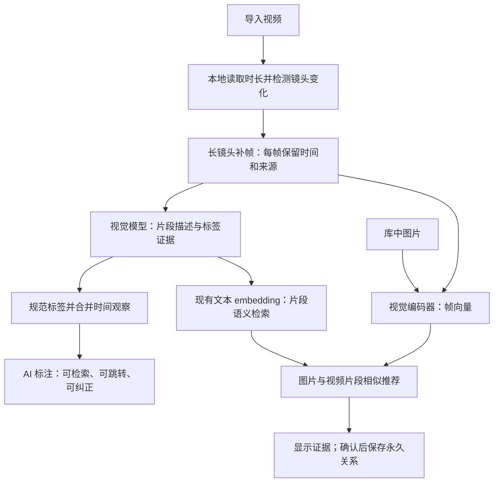

# 混合视频自动标注与关联：推荐方案

日期：2026-09-12。状态：首版代码已实现，真实视频处理已验证；真实视觉模型质量尚未评测。下文保留设计依据，当前实现与验证以本节记录为准。

用户已确认：混合素材，主要依据画面打标签和关联。尚未明确完全离线、显卡和素材规模；这些影响模型部署与吞吐，不阻塞架构选择。本轮不下载模型、不向外部模型发送用户视频。

## 首版实施记录

- 新增 schema 32 与独立视频分析服务、HTTP/CLI 和设置界面。默认关闭自动分析、采用建议模式；启用后处理库中未分析的视频（含既有视频）。支持预算内分批、部分完成、继续/重跑/取消及重启恢复。
- FFmpeg 本地按镜头变化和周期采样，返回独立证据帧；帧时间直接对应 HTML video.currentTime，不能减去非零起始 PTS。已用真实 Chromium 对正起点 MP4/WebM 进行画面像素核对，并验证 VFR、短镜头、帧/字节预算、取消和续跑。
- Codex 视频输出使用独立 schema 和不覆盖的多帧附件。原始观察、AI 标注与人工标注各有归属；接受/拒绝使用 revision，人工修正同步使旧 AI 文本索引失效。人工说明和标签也进入片段文本检索，旧搜索快照在返回前再次校验。
- 本地 SigLIP2 服务脚本、模型空间校验、图像/帧视觉索引和片段文字向量已接通。图片/视频详情提供相似素材与按时间跳转，明确“不再推荐”可持久保存。视觉与文本空间分开；派生路径相对数据目录保存，备份迁移不依赖原机器绝对路径。
- 单批结果做保守的证据合并；首版未提供单独调整合并规则后重新处理历史观察的界面。全片标签继续由用户管理，已应用片段标签投影到库搜索。相似检索输出候选，不自动建立生成来源或身份关系。
- Python 编码服务为独立可选进程，安装包携带脚本与依赖清单；不自动下载模型。真实模型权重、推理依赖与用户素材质量评测仍需实际部署后完成，不能把测试用编码器的检索结果当成 SigLIP2 质量证明。

验证覆盖真实 FFmpeg/Chromium、实际 Codex 子进程协议 fixture、HTTP→SQLite→播放器/索引链路、人工纠错、推荐抑制、迁移/生命周期、界面和 Windows 安装包。全仓测试及最终专项结果见本文末尾验证记录。

## 结论

采用 **本地 FFmpeg 分段抽帧 + 通用视觉模型生成时间标签 + 独立视觉向量召回 + 人工可纠正的 AI 结果**。片段描述同时进入现有文本语义检索，图片与视频帧进入同一个视觉模型空间。

自动化承担读画面、生成标签、定位片段、寻找相似内容；用户可以直接使用 AI 结果并纠错。确认永久关系与修正错误不等于逐条手工标注。

这是结合当前仓库维护成本和使用目标作出的推荐，不是已经测出的模型质量冠军。完整第一版应包含视觉相似推荐；只有“描述转文本向量”的版本可以作为中间交付，不能称为完整视觉关联。

## 已核实的仓库事实

| 当前能力 | 对实现的影响 |
| --- | --- |
| 视频原文件、去重、Range 播放、手动时间点/区间标注、反向引用已具备 | 复用视频元素和播放器定位；抽帧不产生新的库元素 |
| marker 有 requestKey 幂等、revision 并发检查，每视频最多 500 条 | 保存可编辑的最终标注；原始识别观察独立保存，不能每帧创建 marker |
| marker 尚无 AI 来源、分析批次、人工接管字段 | 先建立归属规则，重跑不得覆盖人工结果 |
| organization 入队、候选和视觉证据目前只支持 text/image | 视频分析需要自己的批次合同，不能仅放开视频类型白名单 |
| 整理 worker 最多 3 轮、累计 8 张图 | 视频改用有界帧批次，每帧保留窗口身份；候选对比另设有界调用 |
| 自动整理实际通过 codex exec --image 推理；app-server 在该执行器中只解析默认模型 | 复用取消、usage、结构化输出等机制；不能宣称现有执行器原生理解视频 |
| 附件文件名当前是 element-${elementId}.webp，schema 只有 organization/image-description | 同一视频多帧会覆盖；必须增加唯一 frameId 和 video-analysis 输出类型 |
| 已有图片说明→文本 embedding、SQLite/sqlite-vec；索引按整元素聚合 | 可复用 embedding 客户端，但新增片段时间映射及独立视觉空间 |

代码依据：`src/server/data/videoMarkerRepository.js`、`videoMarkerMigration.js`、`organizationRepository.js`；`src/agent/main.js`、`executors/codexCli.js`；`src/server/data/semanticRepository.js`、`elementLifecycleMigration.js` 和 `src/server/application/semanticService.js`。旧设计文档包含历史状态，应以这些当前代码为准。

## 成熟项目真正值得借鉴的部分

| 参考 | 已核实的做法 | 在本项目中的取舍 |
| --- | --- | --- |
| Immich | CLIP 类模型编码媒体，后台建立向量索引，支持内容搜索；视频机器学习基于生成的缩略图 | 借视觉召回和后台任务模式；扩展为带时间的多帧，不能用一张封面代表全视频。[搜索](https://docs.immich.app/features/searching/)、[FAQ](https://docs.immich.app/FAQ/)、[实现](https://github.com/immich-app/immich/blob/main/server/src/services/smart-info.service.ts) |
| Stash / AI Overhaul 的 Skier AI Tagging 插件 | 按时间间隔识别，持久化时间观察，再按标签合并邻近区间、过滤短区间；整片标签另做聚合 | 借采样、缓存、后处理分离。其模型面向特定内容域，不作为混合素材的通用模型；插件的成熟度也不能等同 Stash 主项目。[采样配置](https://github.com/skier233/AIOverhaul_Plugin_Catalog_Official/blob/main/skier_aitagging/plugin.yml)、[区间处理](https://github.com/skier233/AIOverhaul_Plugin_Catalog_Official/blob/main/skier_aitagging/marker_handling.py) |
| Azure Video Indexer | 标签有重复出现的 instances，每个实例带 start/end/confidence | 借带时间的证据结构；完整托管服务不作为本地工具的必选依赖。[官方结构](https://learn.microsoft.com/en-us/azure/azure-video-indexer/labels-identification-insight) |
| FiftyOne | 支持时间事件、帧数据集及向量相似检索 | 借评测与片段数据表示；不把整个数据集标注平台嵌进 Wiki。[时间标注](https://docs.voxel51.com/user_guide/using_datasets.html#temporal-detection)、[相似检索](https://docs.voxel51.com/user_guide/similarity.html) |

Stash 另有通过指纹/外部资料库匹配元数据的路线。这解决“已知作品是什么”，与“自有混合片段出现了什么”不同，不能拿元数据抓取的成功率替代视觉识别质量。[Stash 官方指南](https://docs.stashapp.cc/guides/scraping-scenes-via-stash-box/)

尤其不照搬插件按 tagId 删除旧 marker 后重建的逻辑：当前插件源码确有此行为，本项目必须按 AI 归属与版本更新，保留手工标注。

## 处理流程与选型

### 1. 本地预处理

使用 FFmpeg/ffprobe 获取可靠时长、流信息和时间戳；检测镜头切换，同时对长镜头定时补帧。仅切镜头会漏连续镜头内的新内容，仅固定间隔会漏短镜头。FFmpeg 的 scdet 已有切换分数与时间元数据，首版无需为切镜头单独引入 Python/PySceneDetect。[FFmpeg 官方文档](https://ffmpeg.org/ffmpeg-filters.html#scdet)

首轮试验参数：按镜头边界划分，长镜头再分约 15 秒的窗口，每窗最多 8 张、通常约 2 秒一张；共享边界证据帧。短镜头也应分配代表帧，不能因总量限制静默跳过。参数属于待测起点，不是质量保证。

逻辑窗口与模型调用批次分开：邻近短镜头可打包成最多 8 帧的一次调用，保留每帧的 windowId、shotId 和时间；跨窗口共享的同一帧只附一次。不得每个一秒镜头都启动一次 CLI，也不得为省调用而把不同镜头的观察合并成一个持续事件。提交和重试按批次执行，覆盖情况按窗口记录。

以解码后的呈现时间映射播放器时间轴，保存时间原点与换算；不能用“帧号/标称 FPS”替代可变帧率视频的时间。旋转信息及画面显示比例纳入派生规则。相邻重复画面可以复用推理，但保留各自时间覆盖；视觉近似哈希只帮助挑帧，不能当内容完全相同的证明。

为每个任务设置解码时限、缓存字节、帧数与模型调用预算。达到预算显示“部分分析”及已覆盖区间，支持继续分析，不能显示全片完成。导入不等后台分析；缺少 FFmpeg 时报告依赖未就绪，视频仍可保存和播放。

### 2. 标签与可读说明

首个适配实现复用已有 Codex 视觉执行器，新增 video-analysis schema，输入独立 frameId、时间、当前窗口和有限词表，输出可观察对象、场景、画面属性、简短说明与 evidenceFrameIds。标签优先映射既有名称和别名，新概念允许提出候选，不能把整份大词表塞进每次调用。

模型处理的是有时间顺序的抽样图像。静态对象与场景适合首版；短暂动作、运动方向、前因后果需要更密采样或真正的视频模型。镜头边界不能直接作为动作起止；只见一帧时保存时间点，区间结果标明“约”并保留采样间隔。毫秒存储精度不表示毫秒识别精度。

相邻同标签观察可以合并，但不得跨未分析空档或无证据的镜头变化。后处理独立版本化，修改别名或合并规则应优先重用观察结果。全片“包含某内容”的检索可从片段标签投影；少量整片摘要标签另做聚合，不把每个短暂对象都提升为用户主标签，也不按抽样帧数量冒充持续时长比例。

本机执行 Codex 不等于离线推理：帧仍会交给已配置模型服务。沿用现有配置入口，首次启用清楚展示发送位置；完全离线有要求时，改用本地通用 VLM。Qwen3-VL 可作为本地候选，但硬件和实际质量未验证。[Qwen 官方仓库](https://github.com/QwenLM/Qwen3-VL)

### 3. 视觉相似与关联

默认评测候选选择 **google/siglip2-base-patch16-224**，对图片和视频帧采用相同的模型、预处理及归一化生成向量。官方模型卡支持图像特征与图文检索；模型体量、部署成本和实际检索质量需要在本机记录，不预先承诺吞吐。[Google 官方模型卡](https://huggingface.co/google/siglip2-base-patch16-224)

部署借鉴 Immich：视觉推理在独立、可关闭的本地 ML 进程中，主应用通过受限接口提交图像，主进程继续拥有队列和数据库。首个实现采用官方 Transformers 模型路径；Python 运行时是视觉检索新增依赖，须纳入安装与打包验证。无需因此引入 Redis、Postgres 或通用插件平台。后续若选 ONNX 导出优化，预处理、输出一致性也需验证。

视觉向量和现有 Qwen 文本向量属于不同空间，不能混算。片段描述用于概念/语义检索，帧向量用于外观相似召回；分别排序后按名次融合，避免直接相加不可比的距离。以图片或片段找素材时优先视觉召回，中文自然语言查询同时使用描述检索与视觉文本编码；多语言效果进入评测。

命中保留 frameId、videoId、时间和对应预览；相邻帧合并为片段，每个视频设置结果配额，避免一个长视频占满 Top-K。不能将整部视频所有帧平均为唯一向量，否则短暂但有用的片段可能被淹没。

“相似素材”自动显示，无需人工逐条建立关系；用户保存为永久链接时写入现有 marker 的关联。相似度不证明同一人物、同一拍摄现场或生成来源，不自动生成这些事实关系。关联文字/提示词继续走语义候选与现有证据规则。

只用 caption embedding 会丢失未写入说明的构图、色调和主体位置，这是信息压缩带来的技术判断；增加视觉向量是否改善用户素材的 Top-K，仍必须通过对照评测确认。

### 4. 为什么暂不选择其他主路线

| 路线 | 本轮决定 |
| --- | --- |
| 直接移植 Stash 专用 tagger | 混合素材标签域不匹配，借流水线，不默认采用专用模型 |
| 只上 CLIP/SigLIP2 | 适合召回或给定词表匹配，不能替代自由标签生成与时间解释 |
| 只生成文字说明 | 能快速接现有检索，但不足以完成外观关联目标 |
| 全量上传云端视频分析 | 可列作效果/成本对照；会新增服务配置、上传和费用，当前已有视觉执行器可先复用 |
| 同时部署 SigLIP2 与大视频 embedding | 首版选择一个视觉 encoder，避免未经验证的重复运行成本 |
| ASR、独立 OCR、物体跟踪、人脸跨视频识别 | 当前画面标签和素材关联不依赖它们，后续按检索失败样本决定 |

原生视频 API 也有采样限制，例如 Gemini 文档说明默认 FPS，并支持裁剪与自定义采样；不能把“原生支持视频”理解成完整看过每一帧。[Gemini 官方文档](https://ai.google.dev/gemini-api/docs/video-understanding)

值得作为后续挑战者的是 **Qwen3-VL-Embedding 2B**：官方支持文字、图片、视频统一检索，FiftyOne 某插件只支持视频互搜是插件限制。若动作/跨模态检索需求或实测收益足够，再用它替换视觉 encoder；它仍不代替生成标签的 VLM。[Qwen 官方仓库](https://github.com/QwenLM/Qwen3-VL-Embedding)

## 数据、任务与人工结果保护

以下是拟新增合同，不是当前代码已有能力：

- 分析 run：videoId、源文件 hash、generation、模型及实际执行模型、提示词/采样/预处理版本、状态、覆盖区间、已用资源与失败原因。窗口任务持久化、租约领取、有界重试，重启从未完成窗口继续。
- 派生 frame：独立 frameId、源 hash、原始呈现时间/归一化时间、缓存定位及预处理版本。文件名不能只用 videoId。帧属于派生资产，不挤进主图库。
- 观察 observation：run/window、规范标签候选、说明、evidenceFrameIds、采样精度。模型自报 confidence 可留诊断，不显示为“正确率”，不单凭它自动应用。
- 可编辑 marker：补 origin、AI run/result 绑定及 revision。人工创建无 AI 归属；人工编辑 AI marker 后成为人工管理，保留历史来源，重跑不能覆盖。人工删除/拒绝保存源内容与标签、区间对应的抑制记录，新运行不能仅换 ID 就重新加回来。

实现中的跨观察抑制采用保守身份：相同规范说明和完整规范标签集合，同时限制原视频内容 hash 与邻近时间范围；与已有人工标注的重复判断也使用同一身份。拒绝所选观察直接按 ID 生效，不因共享“户外”等泛标签撤销其他观察。重跑改写说明或增减标签时，不能仅凭现有字段可靠判定为同一被拒语义；这类结果仍可能形成新建议，人工标注不会被覆盖。迁移 33 为拒绝记录增加说明身份，标签别名改变时同步失效文本索引及已失效的 AI 应用绑定。旧 v32 拒绝记录均未保存说明，升级保留已有决定，停止其对后续观察的宽泛匹配。
- 索引文档：区分 image、video-frame、video-segment，保存 elementId、时间范围和 run 版本。视觉空间记录模型权重修订、维数、预处理和归一化；描述文本沿用文本空间，但新增片段映射，避免污染现有 element/chunk 主键。

原始观察先完成并校验，再聚合为 AI 结果。默认可以展示可检索的 AI 标注，清楚标出来源；写入用户可编辑 marker 或主标签仍遵循 suggest/auto 模式。选择 auto 后，对允许类别且有有效帧证据的标注自动应用，用户只需纠错；不要求每条确认。首批质量不足时保留建议模式，不把未经校准的模型分数设成万能开关。

原始 observation/caption 只作历史证据与重新处理输入，不能绕过人工决定直接进入当前查询。展示、标签过滤、片段说明检索和关联证据统一读取有效结果投影：活动分析结果先叠加人工覆盖、拒绝和接管记录，再发布。人工 marker 使用独立投影键，AI 重跑不能替换其索引文档。

人工把“猫”改成“狗”或拒绝该观察时，同一个短事务递增对应片段的 correctionRevision，使旧标签投影及受影响的 AI 说明文档立即失效，并入队重建；说明未重新生成前只显示可用的人工说明和未受影响内容，不继续展示旧 AI 描述。后台重建和后处理都须核对 correctionRevision，旧任务不得重新激活错误说明。拒绝关联则按源、目标及关系语义抑制重复推荐。帧视觉向量可以保留，因为它编码实际图像而不声明被拒绝标签；视觉相似分数不能用来恢复已否定的标签或关系。

重跑只更新本功能仍拥有且未被人工修改的记录。与人工 marker 同概念、相近区间时保留人工版本并附候选证据，不重复自动创建。达到现有 500 marker 上限时保留观察与检索结果，标明部分未应用，不能删旧人工标注腾位置。

每次提交校验源 hash/版本、活动 generation、租约和删除状态；接受建议时校验 marker revision、目标存在性及词表当前状态。视频长任务不能因全库任意无关编辑而重新推理。推理和 FFmpeg 全程在数据库事务外，短事务提交结果及所拥有的绑定。

取消、配置切换和重试使用新 generation，拒绝旧进程迟到写入。分析失败保留上次可用 AI 结果；向量只有模型空间兼容时才能继续查询。当前文本索引只有一套活动空间，换模型后逐步重建，不能承诺现有系统支持双索引无缝切换。

源视频移入回收站后隐藏 AI 搜索命中并取消在途任务；恢复时仅复用源和配置仍兼容的结果。永久删除级联清理观察、索引和自有派生缓存；关联目标删除按既有 marker 生命周期规则处理。清理只能遍历本功能的缓存根和归属记录。

## 实施顺序与验收

1. **小样本验证**：用同一批混合素材核验时间戳、抽帧覆盖与模型多图识别；比较“描述检索”与“描述 + SigLIP2”两条路线。先固定可用模型/权重版本和资源预算，再全库运行。
2. **自动标注闭环**：加入 FFmpeg、窗口任务、视频输出 schema、AI 来源与人工保护；导入后生成时间标签，详情可跳转，重试不重复。接入片段描述搜索，这是可先交付的一步。
3. **完整第一版**：加入视觉 encoder 与图片/视频帧索引，提供带时间证据的相似推荐、模型空间管理和受限资源运行。完成这一步，才满足“画面打标签 + 视觉关联”的整体目标。

初始评测集建议 20–30 段、覆盖长短镜头、静态画面、快速剪辑、重复画面、动画/实拍、横竖屏与可变帧率；另留不同文件作为验收集，避免在同一素材上调参并宣布成功。质量指标分别记录：

- 标签 precision、预先人工列出的重要概念 recall；持续内容与短暂事件分开统计。
- 标签首次命中时间误差、短事件漏检；对稳定可定义的事件才比较区间边界，不拿镜头切分准确率代替动作定位准确率。
- 概念查询与外观查询分别测 Top-5 相关率及已知相关目标召回；比较描述基线与融合版本。
- 每分钟素材的模型调用数、token/实际费用（能获取时）、总耗时、峰值内存/显存与缓存空间；预算耗尽时的覆盖状态。

作为上线前的初始目标，可将客观标签 precision ≥90%、Top-5 相关率 ≥80% 用于选择默认自动化范围；这是待用户素材验证的产品目标，不是现有结果，也不涵盖细粒度动作。样本量和失败案例必须随比例一起报告；视觉分支只有在外观查询上显示收益且资源可接受时才默认启用。

工程验收覆盖：独立多帧身份、短镜头合批、可变帧率定位、窗口衔接、部分完成、损坏视频、取消/重启、旧结果迟到、重跑幂等、人工接管与拒绝、500 条限制、模型同维数换版本、回收站/永久删除、Windows 打包和未安装推理依赖的降级状态。专门验证改/拒绝 AI 标签后，旧标签过滤与旧说明立即失效，关联不再引用它们，迟到重建也不能恢复；原始观察仍可在历史记录中追溯。

本轮未运行真实模型或性能测试，不给出 GPU 型号要求、每小时成本和准确率实测值。模型与预算需用上述验证确定；无需因此停下抽帧、任务、时间证据和人工保护的设计。

## 设计复核记录

2026-09-12 按 sr-review 完成独立冷审与修复复核。首轮发现人工纠错只保护 marker、未覆盖 AI 搜索投影；已补有效投影、correctionRevision、同步失效与异步重建及验收。同时补充短镜头合批，避免按镜头数放大 CLI 调用。修复复核结论为 APPROVED；边界仅为设计与相关代码/官方资料核对，不代表实现、模型质量或性能已通过验收。

## 实施验证记录（2026-09-12）

- 最新视频自动分析专项：28/28 通过，包含数据、服务、真实 FFmpeg/Chromium、多图执行器协议和界面；没有跳过。模型调用与视觉向量返回采用受控测试服务，验证协议与一致性。
- 全仓 `npm run check` 的测试阶段：528 项中 527 通过，1 项既有长详情滚动用例超时。该纯文本用例独立一次复跑通过；此前手动视频版本已有同一波动。本轮没有修改其滚动逻辑，也不把定点复跑描述为全仓全部通过。
- 构建、Windows `package:dir`、架构检查通过。将安装包 resources 复制到源码目录之外，用包内 Node 启动；语义状态与视频分析状态 API 均返回 200，sqlite-vec 可加载，视频配置和 Python 服务脚本确实随包提供。
- 独立实现复核修复了：异步检索返回旧纠错证据、配置写盘失败后无法恢复、仅帧查询未应用源视频过滤、非零 PTS 跳转偏移、模型与 processor 快照不一致、SigLIP2 文本未按模型位置上限截断/补齐等问题。
- 未安装或运行真实 SigLIP2 依赖/权重，未向真实视觉模型发送用户素材，未测量本机模型吞吐或标签准确率。Python 命令入口、缺依赖诊断及官方模型接口已核对；实际使用需完成 README 的依赖配置。
